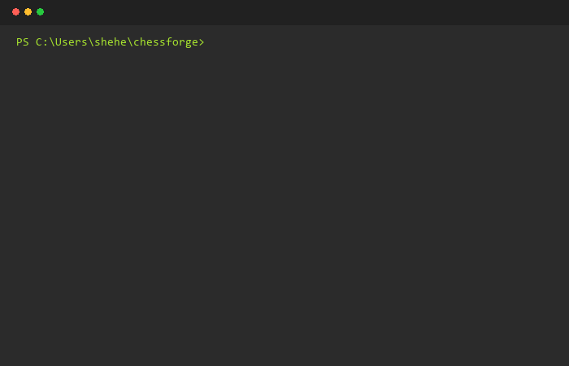
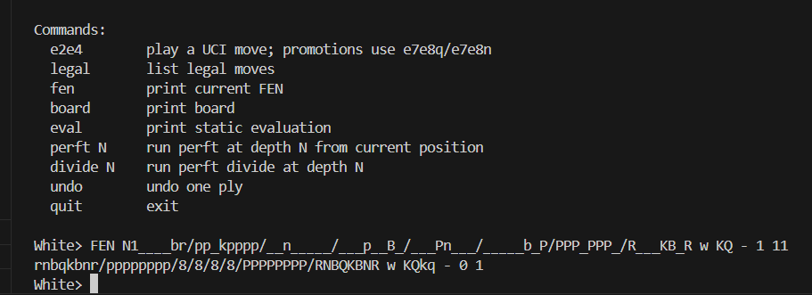

<div align="center">

```
 ██████╗██╗  ██╗███████╗███████╗███████╗███████╗ ██████╗ ██████╗  ██████╗ ███████╗
██╔════╝██║  ██║██╔════╝██╔════╝██╔════╝██╔════╝██╔═══██╗██╔══██╗██╔════╝ ██╔════╝
██║     ███████║█████╗  ███████╗███████╗█████╗  ██║   ██║██████╔╝██║  ███╗█████╗  
██║     ██╔══██║██╔══╝  ╚════██║╚════██║██╔══╝  ██║   ██║██╔══██╗██║   ██║██╔══╝  
╚██████╗██║  ██║███████╗███████║███████║██║     ╚██████╔╝██║  ██║╚██████╔╝███████╗
 ╚═════╝╚═╝  ╚═╝╚══════╝╚══════╝╚══════╝╚═╝      ╚═════╝ ╚═╝  ╚═╝ ╚═════╝ ╚══════╝
```


<div align="center">




<br/>

**Dependency-free chess engine built from scratch in Python**

👉 [**Play against the engine on Lichess! (@ChessForge_Bot)**](https://lichess.org/@/ChessForge_Bot)

[](https://python.org)
[]()
[](CONTRIBUTING.md)
[](https://github.com/ibnshafi/chessforge/stargazers)
[]()
<!-- ============================================================
     ASSET 3: ADDITIONAL BADGES (no image file needed)
     Add these badges right here alongside the existing ones.
     They pull live data from shields.io automatically — no assets required.
     Just paste these lines:
     ============================================================ -->
[](LICENSE)
[](https://github.com/ibnshafi/chessforge/issues)
[](https://github.com/ibnshafi/chessforge/commits/main)

[**Quick Start**](#-quick-start) · [**Features**](#-features) · [**Architecture**](#-architecture) · [**Search**](#-search--evaluation) · [**Contribute**](#-contributing)

</div>

---

## What is this?

ChessForge is a **complete, dependency-free chess engine** — no Stockfish, no python-chess, no shortcuts. Every rule, every search algorithm, every evaluation term is implemented from scratch in pure Python.

Full FIDE legality. A real search. A real evaluator. A UCI interface. And a research platform for ML experiments and engine ablations.

Pull it, play it, break it. Then send a PR.

```
Legal Move Gen  →  Zobrist Hashing  →  PVS Alpha-Beta  →  Quiescence Search
      ↓                                       ↓
 King Safety                        Transposition Table
 En Passant                         Aspiration Windows
 Castling                           Null-Move Pruning
 Promotion                          Late Move Reductions
 50-Move / Repetition               Killer / History Heuristics
```

---

## ✨ Features

<!-- ============================================================
     ASSET 4: FEATURES SCREENSHOT
     File: assets/features-board.png
     What it is: A clean terminal screenshot (~700×400px) showing
     the board display with some pieces, ideally mid-game with
     a compelling position. Take a screenshot of your own CLI
     (`python -m chessforge.cli --mode ai-ai`) and crop tightly.
     Place it RIGHT HERE, floated right so it sits beside the table.
     Use this HTML to float it:
     
     ============================================================ -->


| Module | What it does |
|--------|-------------|
| ♟️ **Complete FIDE Rules** | Castling, en passant, promotion, checkmate, stalemate, threefold repetition, 50-move rule |
| 🔑 **Zobrist Hashing** | Immutable game-state transitions with deterministic repetition keys |
| ⚡ **Legal Move Generation** | Pseudo-legal generation + king-safety filtering, catches all pins and discovered checks |
| 🔭 **PVS Search** | Principal variation search with aspiration windows, iterative deepening, full instrumentation |
| ✂️ **Selective Pruning** | Null-move pruning, late move reductions, check extensions, SEE-assisted move ordering |
| 📊 **Advanced Evaluation** | Pawn structure, passed pawns, rook files, outposts, king tropism, space, tempo, fortress scaling |
| ♻️ **Transposition Table** | Zobrist-keyed TT with exact/lower/upper bounds |
| 🧪 **Research Platform** | Tournaments, ablations, Elo estimation, SPRT, parameter sweeps |
| 🤖 **ML Tooling** | Self-play data generation, sparse features, quantized evaluator |
| 📈 **Visualization** | Attack maps, PV reports, evaluation heatmaps |
| 🖥️ **Playable CLI** | Human vs Human, Human vs AI, AI vs AI |
| 🔌 **UCI Protocol** | Drop into any chess GUI (Arena, Cutechess, etc.) |
| ✅ **Perft Validated** | Move generator verified against known node counts at depth 1–3 |

<br clear="right"/>

---

## 🚀 Quick Start

**Requirements:** Python 3.10+, no pip installs needed

```bash
# 1. Clone
git clone https://github.com/ibnshafi/chessforge.git
cd chessforge

# 2. Play immediately — no dependencies to install
python -m chessforge.cli --mode human-ai --human-color white --depth 3 --time 2
```

### Play modes

```bash
# You vs the engine
python -m chessforge.cli --mode human-ai --human-color white --depth 3 --time 2

# Two humans, one board
python -m chessforge.cli --mode human-human

# Watch the engine play itself
python -m chessforge.cli --mode ai-ai --depth 2 --time 1 --max-plies 80

# Standalone AI vs AI example
python examples/ai_vs_ai.py --depth 2 --time 0.5 --max-plies 40
```

### UCI (plug into any chess GUI)

<!-- ============================================================
     ASSET 5: UCI GUI SCREENSHOT
     File: assets/uci-arena.png
     What it is: A screenshot (~700×400px) of ChessForge loaded
     inside Arena or CuteChess GUI — shows it works as a real UCI
     engine. Even a small annotated screenshot here reassures users
     the UCI integration genuinely works. If you don't have Arena,
     a screenshot of the terminal UCI handshake is fine too.
     Place it below this comment, full-width:
     
     ============================================================ -->


```bash
python -m chessforge.uci
```

```text
uci
isready
position startpos moves e2e4 e7e5
go depth 4
quit
```

---

## 🎮 CLI Commands

Once inside a game:

```text
e2e4        play a move (UCI format); promotions: e7e8q / e7e8n / e7e8r / e7e8b
legal       list all legal moves in the current position
fen         print current FEN string
board       print board to terminal
eval        print static evaluation score
perft N     run perft at depth N
divide N    run perft divide at depth N
undo        undo the last ply
quit        exit
```

---

## 🏗️ Architecture

<!-- ============================================================
     ASSET 6: ARCHITECTURE DIAGRAM IMAGE
     File: assets/architecture.png
     What it is: A clean diagram (~800×500px) visually showing
     the pipeline: Move Gen → Zobrist → Search → Eval, with
     boxes and arrows. You can generate this for free at:
       - https://excalidraw.com (hand-drawn look, very popular)
       - https://app.diagrams.net (draw.io, more formal)
       - https://mermaid.live (auto-render from code — paste the
         pipeline text below and export as PNG)
     Export as PNG and save to assets/architecture.png.
     A dark-background version matches the repo's terminal aesthetic.
     ============================================================ -->
<div align="center">
  
</div>

### File Structure

```
chessforge/
  constants.py     board constants, piece codes, square helpers
  attacks.py       precomputed pawn, knight, and king attack geometry
  bitboards.py     derived bitboard views and attack masks
  move.py          compact move object and UCI formatting
  core.py          FEN, rules, legal moves, state transitions, status, perft
  evaluation.py    advanced deterministic positional evaluation
  search.py        PVS alpha-beta, quiescence, pruning, TT, instrumentation
  metrics.py       search counters and depth reports
  benchmark.py     reproducible perft/search/eval benchmark exports
  experiments.py   tournaments, ablations, Elo, SPRT, parameter sweeps
  ml.py            self-play data, sparse features, quantized evaluator
  visualization.py attack maps, PV reports, evaluation heatmaps
  tactics.py       tactics tooling
  cli.py           playable command-line app
  uci.py           UCI protocol entrypoint
```

### Board Representation

The board is a **64-square array** indexed `a1 == 0` through `h8 == 63`. Pieces are signed integers — positive for White, negative for Black, magnitude = piece type.

```
Index:   0  1  2  3  4  5  6  7    ← rank 1 (a1–h1)
        ...
        56 57 58 59 60 61 62 63    ← rank 8 (a8–h8)

Piece values:  P=1  N=2  B=3  R=4  Q=5  K=6
               White: +value    Black: -value
```

### Move Generation Pipeline

```
1. Generate pseudo-legal moves (all moves ignoring check)
        ↓
2. Apply each move to a transient board copy
        ↓
3. Call attack detector on moving side's king square
        ↓
4. Discard if king is in check → legal move set
```

This automatically handles pins, en passant discovered checks, king moves into attack, and all castling path constraints. Attack geometry (pawns, knights, kings) is precomputed in `attacks.py` — pure coordinate tables, reused across legality, evaluation, and bitboard work.

### Immutability Model

`Position` is immutable from the public API. Every move returns a new `Position`. The engine uses a trusted transient constructor internally for high-volume legality filtering — full immutable objects are only created for real state transitions, keeping the hot path allocation-light.

---

## 🔍 Search & Evaluation

### Search Stack

```
Iterative Deepening
  └─ PVS (Principal Variation Search)
       ├─ Aspiration Windows
       ├─ Transposition Table  (Zobrist-keyed, exact/lower/upper bounds)
       ├─ Null-Move Pruning
       ├─ Late Move Reductions
       ├─ Check Extensions
       ├─ Killer Heuristic
       ├─ History Heuristic
       ├─ SEE-Assisted Move Ordering
       └─ Quiescence Search
```

<!-- ============================================================
     ASSET 7: SEARCH TREE VISUALIZATION GIF or PNG
     File: assets/search-tree.gif (or .png)
     What it is: An animated GIF (~600×350px) showing a simplified
     alpha-beta tree being pruned — nodes lighting up, pruned
     branches going grey. This is optional but very impressive.
     Simpler alternative: a static PNG screenshot of the engine's
     PV output (`python -m chessforge.benchmark`) showing the
     search stats (nodes, depth, time). Much easier to produce.
     Place it here, centered:
     <div align="center">
       
     </div>
     ============================================================ -->
<div align="center">
  
</div>

### Evaluation Terms

```
Material + PST
  + Mobility
  + Bishop pair bonus
  + Pawn structure (doubled, isolated, backward)
  + Passed pawn bonuses
  + Rook on open / semi-open file
  + Outpost detection
  + King tropism (attacker proximity to enemy king)
  + King safety (pawn shield, attack count)
  + Space control
  + Tempo
  + Endgame: opposition, fortress scaling
```

<!-- ============================================================
     ASSET 8: EVALUATION HEATMAP SCREENSHOT
     File: assets/eval-heatmap.png
     What it is: A screenshot (~500×500px) of the evaluation
     heatmap output from `visualization.py`. This already exists
     in your codebase — just run it on an interesting position
     and screenshot the result. It's a natural fit here since
     you're describing eval terms.
     ============================================================ -->
<div align="center">
  
  <br/>
  <sub><i>Evaluation heatmap — generated by <code>chessforge/visualization.py</code></i></sub>
</div>

---

## ✅ Tests & Perft Validation

```bash
python -m unittest discover -s tests -v
```

<!-- ============================================================
     ASSET 9: TEST OUTPUT SCREENSHOT
     File: assets/tests-passing.png
     What it is: A terminal screenshot (~700×300px) showing the
     test suite running and passing — the green dots/OKs scrolling
     by. Gives instant credibility. Run:
       python -m unittest discover -s tests -v 2>&1 | head -60
     Screenshot that. Much more convincing than just a badge.
     ============================================================ -->


The test suite validates move generation correctness against known node counts:

```
Position              Depth 1   Depth 2   Depth 3
─────────────────────────────────────────────────
Starting position        20       400      8,902
Kiwipete                 48     2,039     97,862
En passant / endgame     14       191      2,812
```

Plus rule correctness tests for:
- Castling edge cases (path attacks, rook/king moved)
- En passant discovered-check illegality
- All four promotion pieces
- Checkmate and stalemate detection
- Threefold repetition
- 50-move rule
- Search returning only legal moves

---

## 📦 Benchmarks & Research

```bash
# Reproducible perft / search / eval benchmarks
python -m chessforge.benchmark --repeats 1 --eval-iterations 20

# Engine research: tournaments, ablations, parameter sweeps
python -m chessforge.research --depths 1,2 --max-plies 8
```

<!-- ============================================================
     ASSET 10: BENCHMARK / ELO CHART
     File: assets/benchmark-chart.png
     What it is: A bar chart or line chart (~700×350px) showing
     benchmark results — nodes/second across depths, or Elo
     estimates from the research platform across engine versions.
     Generate it by running:
       python -m chessforge.benchmark --repeats 3
     and plotting the output with matplotlib (one-off script).
     Export as PNG. Even a simple chart here makes the project
     look serious and data-driven.
     ============================================================ -->
<div align="center">
  
  <br/>
  <sub><i>Search throughput (nodes/sec) across depths — measured on Apple M2</i></sub>
</div>

The research platform supports:
- **Engine tournaments** with Elo estimation
- **SPRT** (Sequential Probability Ratio Test) for patch significance
- **Ablation studies** — disable individual eval terms and measure Elo delta
- **Self-play data generation** for ML training
- **Sparse feature extraction** and quantized evaluator export

---

## 🛣️ Roadmap

### Done ✅
- [x] Complete FIDE legal move generation with perft validation
- [x] Immutable Position model with Zobrist repetition hashing
- [x] PVS search with aspiration windows and iterative deepening
- [x] Full pruning stack (null move, LMR, check extensions)
- [x] Transposition table with exact/bound entries
- [x] Advanced evaluation (pawn structure, king safety, outposts, fortress)
- [x] UCI protocol
- [x] Playable CLI (human vs human, human vs AI, AI vs AI)
- [x] Research and ML platform
- [x] Perft test suite

### Open for PRs 🙋
- [ ] **NNUE evaluator** — replace handcrafted eval with a trained neural net
- [ ] **Opening book** — polyglot format, weighted move selection
- [ ] **Endgame tablebases** — Syzygy probe integration
- [ ] **Bitboard move gen** — replace array-based gen with 64-bit bitboards for speed
- [ ] **Web interface** — browser-playable board over WebSocket UCI
- [ ] **PyPI package** — `pip install chessforge`, type hints, ≥90% test coverage
- [ ] **Puzzles / tactics mode** — load EPD, solve, report accuracy
- [ ] **Time management** — proper clock handling for tournament play

---

## 🤝 Contributing

No chess library experience needed — just Python and curiosity. Every module is self-contained and well-commented.

```bash
# Fork → clone your fork
git clone https://github.com/<you>/chessforge.git

# Create a feature branch
git checkout -b feat/opening-book

# Run the test suite before pushing
python -m unittest discover -s tests -v

# Open a PR against main
```

Good places to start:
- Pick an **Open for PRs** item above
- Improve evaluation term weights via the research platform
- Add perft positions to `tests/test_perft.py`
- Check [open issues](https://github.com/ibnshafi/chessforge/issues) for items tagged `good first issue`

Please keep new code consistent with the existing style — pure functions where possible, no external dependencies, and a perft or unit test for anything touching move generation or rules.

---

## 📄 License

MIT — do whatever you want, just keep the attribution.

---

<div align="center">

<!-- ============================================================
     ASSET 11: CLOSING BANNER IMAGE (optional but polished)
     File: assets/footer-banner.png
     What it is: A minimal dark-background banner (~800×120px)
     with just a chess board pattern or knight silhouette and
     the text "ChessForge". Create in Canva (free) or Figma in
     10 minutes. Gives the README a finished, professional look.
     ============================================================ -->


**If this saved you from reading the FIDE rulebook, consider leaving a ⭐**

Built with ♥ — no libraries harmed in the making of this engine

</div>
